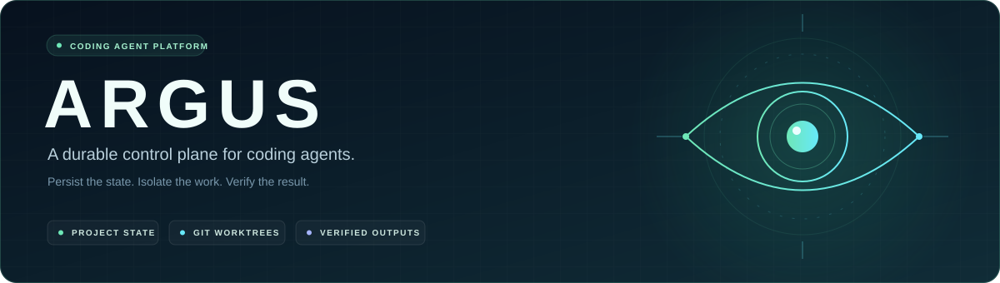
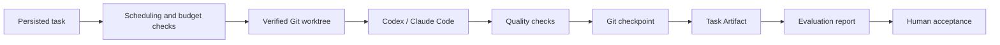

<div align="center">



**Recoverable, verifiable, traceable work for coding agents.**

Project state · Task scheduling · Isolated execution · Git artifacts · Human acceptance

[](docs/OPEN_SOURCE_STATUS.md)
[](Cargo.toml)
[](migrations)
[](LICENSE)

[简体中文](README.md) · **English**

[Quick start](#quick-start) · [How it works](#how-it-works) · [Current boundaries](#current-boundaries) · [Documentation](#documentation)

</div>

---

Argus is a Rust platform for coding-agent execution and project state. It persists tasks and project facts, schedules external coding agents in dedicated Git worktrees, and records test evidence, Git checkpoints, and evaluation reports so project progress survives process restarts and individual conversations.

The default executor is **Codex CLI**, with **Claude Code** available through configuration. Argus manages execution constraints, state, and artifacts; the coding agent handles implementation.

> [!NOTE]
> Current stage: **V0.45 Evaluation Harness foundation / developer-preview / alpha**. Implemented capabilities and limits are described below. See the [master roadmap](docs/MASTER_ROADMAP.md) for the longer-term direction.

## Why Argus

Sustained project work with coding agents needs durable records for recovery, context, cost, and completion.

| Problem | Argus approach |
| --- | --- |
| Interrupted executions leave unclear progress | PostgreSQL-backed tasks, execution leases, and recovery state |
| Changes from different tasks interfere | An isolated, verified Git worktree for each task |
| Project facts are scattered across conversations | Structured Project State and role-specific context compilation |
| A finished process provides little completion evidence | Persisted test results, Git checkpoints, Task Artifacts, and evaluation reports |
| Plans and completion need operator review | Explicit planning approval and separate human acceptance after verification |

## How it works



- **Project State** stores work items, milestones, decisions, risks, blockers, and activity history, with evidence-based progress records.
- **Context Compiler** prepares context for a specific role. **Planner Harness** receives, validates, and applies approved structured planning proposals.
- **Execution** checks permissions, budget, and workspace integrity before invoking the configured coding CLI. After quality checks pass, Argus creates a Git checkpoint and persists its artifact record.
- **Evaluation Harness** checks artifact, test, and Git evidence and stores a report. Passing verification and human acceptance are separate steps for the linked WorkItem.

See [current boundaries](#current-boundaries) for how planning, provider selection, and execution are connected today.

## Implemented foundations

| Capability | Current implementation |
| --- | --- |
| Reliable task execution | Durable scheduling, dependencies, idempotent creation, execution leases, crash recovery |
| Workspaces and artifacts | Isolated Git worktrees, workspace validation, quality gates, Git checkpoints, durable Task Artifacts |
| Project state and context | Structured project state, roadmap and progress records, role-specific context compilation |
| Planning and resource selection | Proposal validation / diffs / approval / application; capability, provider, auth, quota, and policy selection foundations |
| Evaluation and audit | Durable evaluation reports, separate operator acceptance, HTTP write authentication, RBAC, action audit |
| UI and interfaces | HTTP API, SSE events, and pages for projects, tasks, deployment records, audit logs, LLM usage, and read-only configuration |

## Quick start

### 1. Prepare your environment

- **Rust 1.85+** and Git.
- **PostgreSQL with pgvector**.
- Install **Codex CLI**, complete its own login or credential setup, and ensure `codex` is on `PATH`.
- The optional dashboard also needs **Node.js 22** and npm.

From the repository root, prepare local configuration. Existing files are preserved:

```bash
git clone https://github.com/cryotx/argus.git
cd argus
./scripts/setup.sh
```

Use an existing PostgreSQL instance, or start the repository's local demo database with Compose:

```bash
docker compose up -d postgres
```

The Compose database credentials are intended for local development only.

### 2. Configure local settings

Edit `.env`:

| Variable | Setting |
| --- | --- |
| `ARGUS_ENV` | Use `development` locally; production also validates chat provider configuration |
| `ARGUS_DATABASE_URL` | PostgreSQL connection string matching your database |
| `ARGUS_MASTER_KEY` | Replace the example placeholder with a random secret |
| `ARGUS_DEFAULT_WORKER` | `codex` (default) or `claude_code` |
| `ARGUS_HTTP_DEVELOPER_TOKEN` | Set for HTTP write operations; at least 32 non-whitespace ASCII characters |
| `ARGUS_HTTP_ADMIN_TOKEN` | Set for administrative actions such as plan approval and operator acceptance; use a distinct credential for each role |
| `ARGUS_QQ_ENABLED` | Set to `false` when not using QQ integration |

The CLI automatically reads `.env` from the repository root. Environment variables override configuration files. Use `openssl rand -hex 32` separately for each secret or HTTP role credential.

Coding CLI authorization is independent of the conversational model API configuration. To use conversational models, edit `config/providers.toml` and set the matching environment variables. The current example enables the NVIDIA provider and reads `NVIDIA_API_KEY`. If unused, set that example provider's `enabled` to `false`.

<details>
<summary>Use Claude Code</summary>

Install and configure Claude Code, ensure `claude` is on `PATH`, and set this in `.env`:

```dotenv
ARGUS_DEFAULT_WORKER=claude_code
```

Alternatively, configure `config/argus.toml`. The environment variable takes precedence:

```toml
[execution]
default_worker = "claude_code"
```

</details>

### 3. Start the service

```bash
cargo run -p argus-cli -- migrate
cargo run -p argus-cli -- run
```

The service listens on `127.0.0.1:3100` by default. Check its status from another terminal:

```bash
curl http://127.0.0.1:3100/api/status
```

Task execution also requires valid project, canonical repository, and task configuration. See [Project State](docs/PROJECT_STATE.md) and the [Evaluation Harness](docs/EVALUATION_HARNESS.md) for project, planning, and acceptance workflows. HTTP writes require the appropriate role's `Authorization: Bearer …` credential.

### 4. Start the dashboard (optional)

Keep the backend running and use a second terminal:

```bash
cd web
npm ci
npm run dev
```

Open **http://localhost:3000**. The development server proxies `/api` requests to local port `3100`. The dashboard currently focuses on monitoring and list views; configuration is a redacted, read-only process snapshot.

<details>
<summary>Try the offline demo first</summary>

```bash
./scripts/demo_vertical_slice.sh --offline
```

Requires Rust and Git, with no PostgreSQL or model credentials. The demo verifies tasks, quality checks, and a Git commit through a deterministic local workflow. It does not invoke a real coding agent.

</details>

## Technical architecture

| Layer | Main technologies and responsibilities |
| --- | --- |
| Core service | Rust 2024, Tokio; scheduling, execution loop, project state, context, planning, evaluation |
| API and CLI | Axum, Clap; HTTP service, operational commands, project workflows |
| Persistence | PostgreSQL, SQLx, pgvector; tasks, projects, artifacts, audit, and memory foundations |
| Coding execution | External CLI, Git worktrees; Codex by default, Claude Code as an option |
| Dashboard | React, TypeScript, Vite, Tailwind CSS; HTTP API and SSE |

The backend consists of **12 Rust crates**. `argus-core` holds core orchestration; `argus-cli` provides startup and HTTP APIs; `argus-worker` and `argus-git` manage execution and code artifacts. Other crates provide LLM, memory, security, MCP, skills, deployment, communication, and monitoring modules. A module's presence does not imply integration with the main execution loop. See the [architecture](docs/ARCHITECTURE.md) for details.

## Current boundaries

- The execution loop uses **one configured executor, sequential tasks, and the Developer role**. Provider selection foundations exist, but do not yet drive automatic multi-provider execution dispatch.
- The planning protocol supports explicit proposals and approvals. An autonomous Planner / Manager, specialized teams, and concurrent multi-project operation remain planned.
- V0.45 evaluation checks test and Git evidence; it does not semantically review natural-language definitions of done.
- Automated integration, PR creation, deployment, and rollback are not connected to the main execution loop. The dashboard does not cover the full planning and evaluation control workflow.
- Git worktrees provide repository isolation; full process isolation is not implemented. Docker sandbox requests are explicitly rejected.
- Read-only APIs retain anonymous Viewer access; HTTP writes require role credentials. The current target is local development. See [SECURITY.md](SECURITY.md).

The [open-source status](docs/OPEN_SOURCE_STATUS.md) and [Project State](docs/PROJECT_STATE.md) describe the complete implementation and verification scope.

## Documentation

| Start here | Covers |
| --- | --- |
| [Project State](docs/PROJECT_STATE.md) | Implemented capabilities and version scope |
| [Master Roadmap](docs/MASTER_ROADMAP.md) | Next stages and architectural principles |
| [Architecture](docs/ARCHITECTURE.md) | System layers and implementation boundaries |
| [Setup Guide](docs/SETUP_GUIDE.md) / [Runbook](docs/RUNBOOK.md) | Configuration, startup, and operations |
| [Evaluation Harness](docs/EVALUATION_HARNESS.md) | Evidence checks, reports, operator acceptance |
| [Models and Providers](docs/LLM_PROVIDER.md) / [API](docs/API_DESIGN.md) | Model integration and interface reference |
| [Architecture Decisions](docs/adr/README.md) / [Deferred Improvements](docs/DEFERRED_IMPROVEMENTS.md) | Design rationale and known gaps |

Most detailed design documents are currently in English.

## Contributing

See the [contribution guide](CONTRIBUTING.md) for the development workflow.

Issues and focused pull requests are welcome. Read [AGENTS.md](AGENTS.md) and follow the existing module conventions before changing code.

```bash
cargo fmt --all -- --check
cargo clippy --workspace --all-targets -- -D warnings
cargo test --workspace
```

Database integration tests require a migrated test database and currently run serially:

```bash
cargo test -p argus-cli -- --ignored --nocapture --test-threads=1
```

Real-agent tests require separate opt-in; regular database E2E suites use deterministic test executors. For frontend checks, run `npm run lint` and `npm run build` inside `web/`.

Follow [SECURITY.md](SECURITY.md) when reporting security issues. Do not include credentials or sensitive data in public issues.

## License

[MIT](LICENSE)
