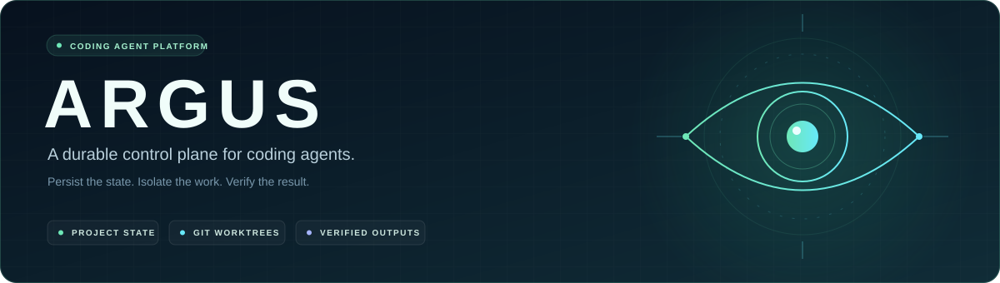

<div align="center">



**让编码 Agent 的工作可恢复、可验证、可追踪。**

项目状态 · 任务调度 · 隔离执行 · Git 产物 · 人工验收

[](docs/OPEN_SOURCE_STATUS.md)
[](Cargo.toml)
[](migrations)
[](LICENSE)

**简体中文** · [English](README.en.md)

[快速开始](#快速开始) · [工作原理](#工作原理) · [当前边界](#当前边界) · [文档](#文档)

</div>

---

Argus 是一个用 Rust 构建的编码 Agent 执行与项目状态平台。它保存任务与项目事实，调度外部编码 Agent，在独立 Git worktree 中执行工作，并记录测试证据、Git checkpoint 和验收报告，让项目进展能够跨越进程重启和单次对话持续保留。

默认执行器为 **Codex CLI**，可配置为 **Claude Code**。Argus 负责执行约束、状态与产物；编码 Agent 负责具体实现。

> [!NOTE]
> 当前处于 **V0.45 验收层基础 / developer-preview / alpha**。已实现能力和限制见下文；长期方向见[主路线图](docs/MASTER_ROADMAP.md)。

## 为什么做 Argus

当编码 Agent 开始承担持续的项目工作，任务恢复、上下文、成本和完成判定都需要持久的依据。

| 需要解决的问题 | Argus 的做法 |
| --- | --- |
| 任务执行中断后，进度难以恢复 | PostgreSQL 持久化任务、执行租约与恢复状态 |
| 不同任务的代码修改相互干扰 | 每个任务使用独立且经过验证的 Git worktree |
| 项目事实散落在多次对话里 | 保存结构化 Project State，并编译角色所需上下文 |
| “执行结束”缺少可核对的完成证据 | 保存测试结果、Git checkpoint、Task Artifact 与验收报告 |
| 规划与完成状态需要人工把关 | 规划提案显式批准，验收通过后仍需独立人工接受 |

## 工作原理


- **项目状态**保存工作项、里程碑、决策、风险、阻塞与活动历史，支持基于证据的进度记录。
- **Context Compiler**从项目状态生成面向特定角色的上下文；**Planner Harness**接收、校验与应用经过批准的结构化规划提案。
- **执行链路**检查权限、预算和工作区，再调用配置的编码 CLI。通过质量检查后，由 Argus 创建 Git checkpoint 并持久化产物记录。
- **Evaluation Harness**检查产物、测试及 Git 证据，保存报告；通过验证与人工接受是两个独立步骤，针对关联的 WorkItem 进行。

规划协议、Provider 选择与执行链路的连接范围见[当前边界](#当前边界)。

## 已实现的基础

| 能力 | 当前实现 |
| --- | --- |
| 可靠任务执行 | 持久化调度、依赖处理、幂等创建、执行租约、崩溃恢复 |
| 工作区与产物 | 独立 Git worktree、工作区校验、质量门禁、Git checkpoint、持久化 Task Artifact |
| 项目状态与上下文 | 结构化项目状态、路线图与进度记录、角色上下文编译 |
| 规划与资源选择 | 规划提案校验 / 差异 / 批准 / 应用；能力、Provider、凭证、配额与策略选择基础 |
| 验收与审计 | 持久化验收报告、独立人工接受、HTTP 写鉴权、RBAC、操作审计 |
| 可视化与接口 | HTTP API、SSE 事件，以及项目、任务、部署记录、审计日志、LLM 用量和只读配置页面 |

## 快速开始

### 1. 准备环境

- **Rust 1.85+** 与 Git。
- **PostgreSQL + pgvector**。
- 安装 **Codex CLI**，完成该 CLI 自身的登录或凭证配置，并确保 `codex` 位于 `PATH` 中。
- 启动管理台另需 **Node.js 22** 与 npm。

获取代码并准备本地配置；脚本只复制尚不存在的文件：

```bash
git clone https://github.com/cryotx/argus.git
cd argus
./scripts/setup.sh
```

已有 PostgreSQL 时可直接使用。需要本地演示数据库时，也可使用仓库内的 Compose 配置：

```bash
docker compose up -d postgres
```

Compose 中的数据库凭证仅用于本地开发。

### 2. 填写本地配置

编辑 `.env`：

| 变量 | 配置说明 |
| --- | --- |
| `ARGUS_ENV` | 本地试用设为 `development`；生产模式还会校验对话 Provider 配置 |
| `ARGUS_DATABASE_URL` | PostgreSQL 连接地址；与本地数据库配置保持一致 |
| `ARGUS_MASTER_KEY` | 将示例占位值替换为随机密钥 |
| `ARGUS_DEFAULT_WORKER` | `codex`（默认）或 `claude_code` |
| `ARGUS_HTTP_DEVELOPER_TOKEN` | 需要执行 HTTP 写操作时设置，至少 32 个非空白 ASCII 字符 |
| `ARGUS_HTTP_ADMIN_TOKEN` | 需要批准规划、人工接受等管理操作时设置；与其他角色使用不同凭证 |
| `ARGUS_QQ_ENABLED` | 不启用 QQ 接入时设为 `false` |

CLI 会自动读取仓库根目录的 `.env`；环境变量优先于配置文件。可用 `openssl rand -hex 32` 为密钥或 HTTP 角色分别生成随机值。

编码 CLI 的授权与对话模型 API 配置相互独立。使用对话模型时，编辑 `config/providers.toml` 并填写对应环境变量；当前示例启用 NVIDIA Provider，使用 `NVIDIA_API_KEY`。不使用时，可将示例 Provider 的 `enabled` 设为 `false`。

<details>
<summary>使用 Claude Code</summary>

安装并配置 Claude Code，确保 `claude` 位于 `PATH`，然后在 `.env` 中设置：

```dotenv
ARGUS_DEFAULT_WORKER=claude_code
```

也可在 `config/argus.toml` 中配置；环境变量仍具有更高优先级：

```toml
[execution]
default_worker = "claude_code"
```

</details>

### 3. 启动服务

```bash
cargo run -p argus-cli -- migrate
cargo run -p argus-cli -- run
```

服务默认监听 `127.0.0.1:3100`。另开终端查看状态：

```bash
curl http://127.0.0.1:3100/api/status
```

任务执行还需要有效的项目、主仓库及任务配置。项目、规划与验收流程见[项目状态](docs/PROJECT_STATE.md)和[验收层文档](docs/EVALUATION_HARNESS.md)；HTTP 写请求需携带相应角色的 `Authorization: Bearer …`。

### 4. 启动管理台（可选）

保持后端运行，在另一终端执行：

```bash
cd web
npm ci
npm run dev
```

打开 **http://localhost:3000**。开发服务器会将 `/api` 请求转发到本机 `3100` 端口。管理台当前以运行监控和列表展示为主，配置页面提供隐藏敏感值的只读快照。

<details>
<summary>只想先体验一次离线演示</summary>

```bash
./scripts/demo_vertical_slice.sh --offline
```

需要 Rust 与 Git，无需 PostgreSQL 或模型凭证。演示使用确定性本地流程验证任务、质量检查与 Git 提交，不调用真实编码 Agent。

</details>

## 技术架构

| 层 | 主要技术与职责 |
| --- | --- |
| 核心服务 | Rust 2024、Tokio；调度、执行循环、项目状态、上下文、规划与验收 |
| API 与命令行 | Axum、Clap；HTTP 服务、运维命令与项目工作流 |
| 数据持久化 | PostgreSQL、SQLx、pgvector；任务、项目、产物、审计与记忆基础 |
| 编码执行 | 外部 CLI、Git worktree；默认 Codex，可选 Claude Code |
| 管理台 | React、TypeScript、Vite、Tailwind CSS；HTTP API 与 SSE |

后端由 **12 个 Rust crate** 组成。核心逻辑位于 `argus-core`，`argus-cli` 负责启动与 API，`argus-worker` 和 `argus-git` 负责执行与代码产物；其余 crate 提供 LLM、记忆、安全、MCP、技能、部署、通信与监控等模块。模块存在并不代表均已贯通主执行循环；详细分层见[架构文档](docs/ARCHITECTURE.md)。

## 当前边界

- 执行循环仍以**单个配置执行器、串行任务和 Developer 角色**为主。Provider 选择基础已实现，尚未成为自动多 Provider 执行调度。
- Planner 协议支持显式提案与批准；自主 Planner / Manager、多角色团队和多项目并发运行仍在规划中。
- V0.45 验收检查测试与 Git 证据，尚不进行自然语言完成标准的语义评审。
- 自动集成、PR 创建、部署和回滚尚未接入主执行循环；管理台也未覆盖完整规划与验收控制流程。
- Git worktree 提供仓库隔离；完整进程隔离尚未实现。请求 Docker 沙箱会被明确拒绝。
- 只读 API 保留匿名 Viewer 访问；HTTP 写操作需要角色凭证。当前面向本地开发使用，安全说明见 [SECURITY.md](SECURITY.md)。

完整实现状态与验证范围以[开源状态](docs/OPEN_SOURCE_STATUS.md)和[项目状态](docs/PROJECT_STATE.md)为准。

## 文档

| 从这里开始 | 内容 |
| --- | --- |
| [项目状态](docs/PROJECT_STATE.md) | 当前已实现能力与版本范围 |
| [主路线图](docs/MASTER_ROADMAP.md) | 后续阶段与架构原则 |
| [架构说明](docs/ARCHITECTURE.md) | 系统分层及实现边界 |
| [首次安装](docs/SETUP_GUIDE.md) / [运行手册](docs/RUNBOOK.md) | 配置、启动与运维 |
| [验收层](docs/EVALUATION_HARNESS.md) | 证据校验、报告与人工接受 |
| [模型与 Provider](docs/LLM_PROVIDER.md) / [API](docs/API_DESIGN.md) | 模型接入与接口参考 |
| [架构决策](docs/adr/README.md) / [已知改进项](docs/DEFERRED_IMPROVEMENTS.md) | 设计依据与待完善事项 |

大部分详细设计文档目前为英文。

## 参与开发

欢迎通过 Issue 反馈问题，或提交范围明确的 Pull Request。开发流程见 [CONTRIBUTING.md](CONTRIBUTING.md)；修改前请阅读 [AGENTS.md](AGENTS.md) 并遵循现有模块风格。

```bash
cargo fmt --all -- --check
cargo clippy --workspace --all-targets -- -D warnings
cargo test --workspace
```

数据库集成测试需要已迁移的测试数据库，当前应串行运行：

```bash
cargo test -p argus-cli -- --ignored --nocapture --test-threads=1
```

真实 Agent 测试需单独选择启用；常规数据库 E2E 使用确定性测试执行器。前端验证命令为 `npm run lint` 和 `npm run build`，在 `web/` 下执行。

报告安全问题请遵循 [SECURITY.md](SECURITY.md)，避免在公开 Issue 中包含凭证或敏感数据。

## 许可证

[MIT](LICENSE)
